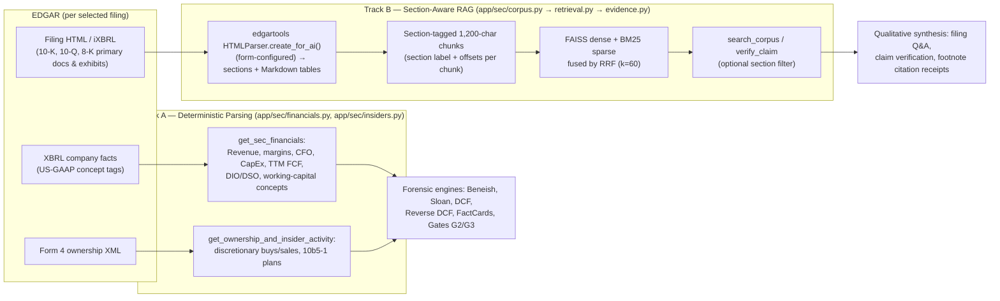

# Deep Research & Valuation Pipeline Architecture

This document details the multi-stage, model-directed research graph, showing how deep research and specialist diligence are cleanly separated between **The Analyst Workbench (Stage 2 Tools)** and **The Investment Committee Boardroom (Stage 5 Governance)**.

---

## 1. End-to-End Pipeline Architecture Diagram

```mermaid
flowchart TD
    %% Global styling
    classDef stage fill:#1e1e2e,stroke:#89b4fa,stroke-width:2px,color:#cdd6f4;
    classDef tool fill:#181825,stroke:#f38ba8,stroke-width:1px,color:#cdd6f4;
    classDef engine fill:#11111b,stroke:#a6e3a1,stroke-width:2px,color:#a6e3a1;
    classDef gate fill:#313244,stroke:#f9e2af,stroke-width:1.5px,color:#fab387;
    classDef read fill:#181825,stroke:#cba6f7,stroke-width:1.5px,color:#cdd6f4;

    START([User Query / Trigger]) --> S1

    %% ==========================================
    %% STAGE 1: PLANNER
    %% ==========================================
    subgraph S1["Stage 1: Model-Driven Planning & Discovery (planner)"]
        direction TB

        subgraph P_ASSESS["1. Model-Driven Scout Assessment (assess_scout_need)"]
            direction TB
            p_eval["<b>LLM Intent & Discovery Evaluator</b><br/>• Deconstructs prompt & identifies target entities<br/>• Fast-Path: Bypass scouting if ticker/company already known<br/>• Widen-First: formulates up to 4 discovery queries<br/>(1-2 screen_stocks presets @ limit=20 + 1-2 web/article/social @ limit≤10)"]
        end

        subgraph P_SCOUT["2. Targeted Preliminary Discovery Tools"]
            direction TB
            p_scr["screen_stocks: Quantitative factor & preset screening (limit ≤ 20/call)"]
            p_web["search_web: Industry rankings & thematic catalysts"]
            p_art["search_articles: Real-time news & regulatory announcements"]
            p_soc["search_social: Retail sentiment & momentum velocity"]
        end

        subgraph P_CUT["2b. Deterministic Shortlist Gate (code, zero LLM)"]
            p_cut["<b>build_deterministic_shortlist</b><br/>• Hard gates: drop rows missing market cap or all valuation multiples<br/>• Cross-sectional percentile composite: 40% value (inverse P/E) +<br/>30% conviction (inverse consensus rating) + 30% size/liquidity (log10 cap)<br/>• Full screener pool (30-40 rows) → top 8 ranked shortlist<br/>• Web-scouted thematic names appended as separate discovery leads"]
        end

        subgraph P_SYNTH["3. Structured Plan & Hypothesis Synthesis (generate_research_plan)"]
            direction TB
            p_plan["<b>ResearchPlanSchema Generator</b><br/>• Decomposes query into 3-5 testable ResearchHypothesis items<br/>• Assigns evidence_tier: structured_quant, primary_regulatory, macro_series, channel_check_primary, open_web<br/>• CONSTRAINT: candidate_entities must come from the deterministic<br/>shortlist ∪ web discovery leads (wide net → narrow deep dive)<br/>• Sets scope (single vs multi-candidate) & execution budget ceiling (25 vs 50)"]
        end

        subgraph P_INIT["4. State & Workspace Hydration"]
            direction TB
            p_seed["<b>Candidate & Queue Hydration</b><br/>• Auto-seeds isolated candidate workspaces (cand_...) for post-cut candidates only<br/>• Hydrates prioritized ResearchWorkItem DAG queue<br/>• Binds budget limits: standard (25) vs deep (50)"]
        end

        p_eval -->|needs_scouting=True| P_SCOUT
        p_eval -->|Fast-Path: known entity| p_plan
        P_SCOUT -->|Screener rows + lead lines| P_CUT
        P_CUT -->|Ranked shortlist + leads| p_plan
        p_plan --> p_seed
    end

    S1 --> S2

    %% ==========================================
    %% STAGE 2: DEEP RESEARCH AGENT LOOP (ANALYST WORKBENCH)
    %% ==========================================
    subgraph S2["Stage 2: Deep Research Agent Loop (executor)"]
        direction TB
        EXEC["<b>Deep Research Agent (The Analyst)</b><br/>(Tool-directed LLM reasoning engine with dynamic routing)"]

        subgraph T_DISC["1. Discovery & Web Intelligence"]
            t_web["search_web: Macro & industry trends"]
            t_art["search_articles & read_article: News & PRs"]
            t_doc["read_document: Analyst reports & PDF parsing"]
            t_soc["search_social: Retail sentiment & momentum"]
        end

        subgraph T_SEC["2. Unified SEC Specialist Sub-Agent (LangGraph)"]
            direction TB
            t_sec_fin["<b>Track A — Deterministic Parsing (no RAG, no LLM)</b><br/>get_sec_financials: Official SEC XBRL accounting<br/>• Form 10-Q YTD Cash Flow De-cumulation<br/>• True Unlevered FCFF Base (CFO + Int*(1-t) - CapEx)<br/>• Operating Leases (ASC 842), Preferred & Minority Claims<br/>• Full Cash Conversion Cycle (DIO + DSO - DPO)"]

            subgraph SEC_SUBAGENT["investigate_sec(ticker, task) Sub-Agent"]
                direction TB
                sec_sub_desc["<b>Autonomous SEC Analyst Loop (StateGraph)</b><br/>Multi-turn filing exploration, claim verification, and synthesis"]
                sec_list["list_filings: Browse EDGAR 10-K/10-Q/8-K catalog"]
                sec_pull["pull_filing: Auto-index on pull — edgartools pre-parsing<br/>sections into tagged Markdown-table chunks (Track B)"]
                sec_search["search_corpus: Section-aware hybrid dense FAISS +<br/>sparse BM25 + RRF with optional section filter (Track B)"]
                sec_chunk["read_chunk: Verbatim footnote & schedule inspection"]
                sec_claim["verify_claim: Ground factual claims vs filings"]
                sec_insider["get_ownership_and_insider_activity:<br/>Deterministic Form 4 XML trade audit (Track A)"]

                sec_sub_desc --> sec_list --> sec_pull --> sec_search --> sec_chunk --> sec_claim
                sec_sub_desc --> sec_insider
            end
        end

        subgraph T_MKT["3. Market, Context & Scuttlebutt Data"]
            t_mkt["get_market_data: Real-time price, volume ratio, 50/200 SMA, ATR<br/>(Point-in-Time windowing: end=as_of_date)"]
            t_co["get_company_research: Wall Street consensus targets & estimates<br/>(Blocked in backtests to eliminate lookahead bias)"]
            t_own["get_ownership_and_insider_activity: Form 4 insider trades (Code P vs S vs F)<br/>(Point-in-Time clamped: date <= as_of_date)"]
            t_macro["get_macro_context: Official FRED Treasury yields, inflation, rates<br/>(Point-in-Time clamped: date <= as_of_date)"]
            t_cc["record_channel_check: Philip Fisher scuttlebutt receipts<br/>(distributor stockouts, spot/contract spreads, lead times,<br/>developer telemetry with defensive alias coercion)"]
        end

        subgraph T_COMP["4. Candidate Screening & Ranking"]
            t_scr["screen_stocks: Keyless factor & preset equity screener"]
            t_reg["register_candidate: Build isolated candidate workspace<br/>(Supports Fast-Path Early Veto: status='vetoed')"]
            t_cmp["compare_candidates: Build normalized cross-peer comparison matrix"]
        end

        subgraph T_DIL["5. Model-Directed Diligence Tools"]
            t_val["evaluate_valuation(ticker)<br/>Reverse DCF inheriting expectation-gap & FRED macro<br/>(InjectedState) + reconciliation vs diligence quant"]
            
            subgraph SUBAGENT["conduct_candidate_diligence(ticker) Sub-Agent — 3-Stage Concurrent Pipeline"]
                direction TB
                ENG_EXP["Expectations Analyst (Mauboussin & DCF)<br/>• Michael Mauboussin Expectations Reverse DCF<br/>(Sales Growth & NOPAT Margin Inversion via I=g/ROIC)<br/>• Deterministic reverse DCF & expectation-edge verdict"]
                ENG_FOR["Forensic Accounting & Balance Sheet Health<br/>• Beneish 8-Factor M-Score & Sloan Accruals<br/>• Altman Z-Score & Z''-Score Distress Models<br/>• 5-Stage DuPont ROE & ROIC/WACC EVA Spread"]
                ENG_MOAT["Moat Analyst (7 Powers)<br/>rating + durability → dossier & CIO payload"]
                ENG_CHAN["Channel Checks Specialist<br/>Point72 Concordance Matrix (Scuttlebutt receipts)"]
                ENG_QNT["Stage 2: Deterministic Quant DCF & Triangulation<br/>calculator.mjs — consumes Stage-1 expectation_gap<br/>• Mid-Year Discounting Convention ((1+r)^(y-0.5))<br/>• Senior Claims EV Bridge (-Leases, -Preferred, -Minority)<br/>• Dynamic FRED DGS10 WACC & Blume Beta<br/>• Multi-Method Triangulation (DCF + Multiples + P/TBV)"]
                ENG_BULL["Bull Advocate<br/>catalysts + numeric bull_target_price (1 structured retry)"]
                ENG_BEAR["Hostile Bear Red Team<br/>kill criteria + numeric bear_floor_price"]

                ENG_EXP --> ENG_QNT
                ENG_FOR --> ENG_QNT
                ENG_MOAT --> ENG_QNT
                ENG_CHAN --> ENG_QNT
                ENG_QNT --> ENG_BULL
                ENG_QNT --> ENG_BEAR
            end
        end

        EXEC --> T_DISC
        EXEC --> T_SEC
        EXEC --> T_MKT
        EXEC --> T_COMP
        EXEC --> T_DIL
        T_DIL -. returns structured dossier .-> EXEC
    end

    %% ==========================================
    %% STAGE 3: INGESTION
    %% ==========================================
    subgraph S3["Stage 3: Evidence Ingestion (ingest)"]
        INGEST["<b>Deterministic Ingest Engine</b><br/>• Normalizes financial tables & ratios<br/>• Distills atomic, cited FactCards into candidate and top state<br/>• Logs immutable SEC receipts to disk ledger<br/>• Stores candidate dossiers into candidate state"]
    end

    T_DISC --> S3
    T_SEC --> S3
    T_MKT --> S3
    T_COMP --> S3
    T_DIL --> S3
    S3 -->|Feedback Loop with Tool Outputs| EXEC

    %% ==========================================
    %% STAGE 4: GAP REFLECTION
    %% ==========================================
    subgraph S4["Stage 4: Gap Reflection (reflect)"]
        REFLECT["<b>Reflection Supervisor</b><br/>• Audits state against ResearchPlanSchema & candidate workspaces<br/>• Catches missing diligence/valuation or unread issuer-relevant PDFs<br/>(SEC.gov or candidate-bound only — junk-domain PDFs excluded)<br/>• Injects targeted gap prompts (up to 2 rounds)<br/>• Fast-Path Early Veto Circuit Breaker (status='vetoed')<br/>  bypasses uninvestable/fraudulent assets cleanly"]
    end

    EXEC -->|Turn Complete / No More Tool Calls| S4
    S4 -->|Gaps Found: Re-enter Research Loop| EXEC

    %% ==========================================
    %% STAGE 5: FINAL AUDIT & GATES (THE BOARDROOM)
    %% ==========================================
    subgraph S5["Stage 5: Final Decision & Governance (diligence_node)"]
        direction TB
        
        G_EV["<b>1. Evidence Gate (G1)</b><br/>Audit check: Are primary SEC citations & market context verified?"]:::gate
        
        PROMO["<b>2. Read Promoted Candidate Dossier</b><br/>Pulls existing DCF, Bull Catalysts, and Bear Kill Triggers<br/>from Stage 2 for the winning/primary candidate"]:::read

        subgraph GATES["3. Governance Gates (Deterministic Instant Math)"]
            G_ACC["<b>Accounting Gate (G2)</b><br/>Beneish M-Score manipulation check (reused from dossier)"]:::gate
            G_VAL["<b>Valuation Gate (G3)</b><br/>DCF growth hurdle reproducibility check (calculator.mjs)"]:::gate
            G_ASYM["<b>Asymmetry Gate (G4)</b><br/>Reward-to-Risk ratio ≥ configured asymmetry_hurdle<br/>(Decoupled Downside: Tangible Book Value or Pullback Floor)"]:::gate
            G_ACC --> G_VAL --> G_ASYM
        end

        COMM["<b>4. Unified Investment Committee (CIO Deliberation)</b><br/>• 3-Way Risk Debate: Conservative vs Aggressive vs Neutral<br/>• Deterministic Risk Limits: 'Conviction requests, risk disposes'<br/>• Tiered Kelly Sizing with Single-Name & Loss Budget Clamps<br/>• Immutable ClampEvent logs & Synchronized Memo Hierarchy"]:::gate

        G_EV --> PROMO --> GATES --> COMM
    end

    S4 -->|Research Complete / Budget Reached| S5
    EXEC -->|Direct Route on Full Completion| S5
    S5 --> END_NODE([<b>Final Universal Memo & Verdict</b>])

    %% Class assignments
    class S1,S2,S3,S4,S5 stage;
    class t_web,t_art,t_doc,t_soc,t_sec_fin,sec_list,sec_pull,sec_search,sec_chunk,sec_claim,sec_insider,t_mkt,t_co,t_own,t_macro,t_cc,t_scr,t_reg,t_cmp,t_val,p_scr,p_web,p_art,p_soc tool;
    class ENG_EXP,ENG_FOR,ENG_MOAT,ENG_CHAN,ENG_QNT,ENG_BULL,ENG_BEAR,sec_sub_desc,p_eval,p_plan,p_seed engine;
    class G_EV,G_ACC,G_VAL,G_ASYM,COMM,GATES gate;
    class PROMO read;
```

---

## 2. Separation of Duties: Analyst (Stage 2) vs Committee (Stage 5)

| Analysis Component | Stage 2 (The Analyst Workbench) | Stage 5 (The Boardroom Committee) |
|---|---|---|
| **Heavy Modeling & Sub-Agents** | Runs per-candidate on demand via `conduct_candidate_diligence(ticker)`: Quant DCF (with mid-year discounting, operating lease EV bridge, dynamic FRED WACC, CapEx normalization, and Multi-Method Triangulation), Forensics (Altman Z-Score, DuPont 5-Stage ROE, ROIC/WACC EVA spread), Moat (7 Powers), Channel Checks (Scuttlebutt receipts & Cash Conversion Cycle), Bull Advocate, and Bear Red Team. Or commands the `investigate_sec` analyst sub-agent for deep filing retrieval. | **Zero engine execution.** It never spins up sub-agents or re-runs models. |
| **Candidate Selection & Screening** | Dynamically screens candidates quantitatively (`screen_stocks`), registers workspaces (`register_candidate`), declares early vetoes (`status='vetoed'`), and builds cross-candidate comparison matrices (`compare_candidates`). | Promotes the **winning candidate's dossier (#1)** into state, auditing its standalone risk/reward and calculating actionable limit order prices (`top_candidate_ticker`). |
| **Evidence & Compliance** | Commands `investigate_sec` to auto-discover, pull, chunk, and cite 10-K/10-Qs; verifies rumors via `verify_sec_claim`. Clamps historical queries to `until=run_as_of` in backtest mode. | Evaluates the **Evidence Gate (G1)**: ensures primary SEC citations and market context exist before voting. |
| **Scuttlebutt Channel Checks** | Ingests primary channel receipts via `record_channel_check` with defensive alias coercion; extracts ground-truth telemetry (developer velocity, distributor lead times, spot-vs-contract spreads, operator chatter); builds Point72 concordance matrix. | Refreshes channel telemetry dynamically; synthesizes **3-Way Expectation Arbitrage**: compares channel momentum ($g_{\text{channel}}$) against reverse DCF implied growth ($g_{\text{implied}}$) and consensus ($g_{\text{consensus}}$). Applies **Scuttlebutt Inflection Exception** when channel acceleration confirms pricing power. |
| **Audit Gates** | Collects raw metrics (deterministic Reverse DCF implied growth, Beneish M-Score, Bear floor, Tangible Book Value per share, Multi-method divergence flag). | Runs **instant mathematical checks**: Accounting Gate (G2), Valuation Gate (G3), and Asymmetry Gate (G4 $\ge$ configured hurdle, with downside floor bounded by Tangible Book Value or contracted support). |
| **Capital Allocation & Sizing** | Formulates thesis, numeric bull target price, and downside floor prices (both debate anchors are validated; missing anchors degrade the report and fall back to labeled Street/DCF anchors). | The **Chief Investment Officer (CIO)** conducts a formal deliberation with enforced anchor provenance, reviews the **3-Way Risk Debate** (Conservative, Aggressive, Neutral), and sizes via **tiered Fractional Kelly** with deterministic risk limits (`apply_risk_limits`, 10-15% single-name cap, 5% max loss budget). Exposure trimmed by clamps stays in cash and emits immutable `clamp_events`. |
| **Macro / Thematic Regimes** | Collects macroeconomic time-series from FRED (`FEDFUNDS`, `DGS10`, `T10Y2Y`, `CPIAUCSL`, `UNRATE`) via `get_macro_context` (clamped to historical `as_of_date`). | In pure top-down investigations, CIO issues a **`MacroDirective`**: classifies policy stance, yield curve slopes, and sector overweight/underweight tilts. |

---

## 3. Data Integrity, Forensics & Evidence Preservation Engine

### 3.1 Form 10-Q Cash Flow De-cumulation Engine
Under SEC Regulation S-X Rule 10-01(a)(4), Form 10-Q cash flows are reported on a cumulative Year-To-Date (YTD) basis:
- **Q1**: 3-month discrete period (~90 days).
- **Q2**: 6-month cumulative period (~180 days).
- **Q3**: 9-month cumulative period (~270 days).
- **Q4 / 10-K**: 12-month annual period (~365 days).

When cumulative amounts are detected, `app/sec/financials.py::_decumulate_cash_flows` derives true discrete quarterly amounts:
$$Q2_{discrete} = YTD_{6M} - Q1_{discrete}$$
$$Q3_{discrete} = YTD_{9M} - YTD_{6M}$$
$$Q4_{discrete} = FY_{12M} - YTD_{9M}$$

The de-cumulated quarterly cash flows are summed across the 4 most recent discrete quarters to compute **True Trailing Twelve Months (TTM) Free Cash Flow** ($FCF_{TTM} = \sum_{k=1}^4 CFO_k - CapEx_k$), which is passed directly to `calculator.mjs` as the annual base cash flow, eliminating historical $2\times$ to $4\times$ DCF valuation distortions. A partial 4-quarter window (any quarter missing CFO or CapEx fields on a given fetch) is **never** annualized or partially summed — `_compute_ttm_fcf` reports `None` instead, because unstable TTM values previously flipped downstream reverse-DCF bases between fetches.

### 3.2 Academic Triad Forensic Accounting Models
`app/market/forensics.py` extracts 8 official US-GAAP balance sheet and cash flow concepts (`total_assets`, `accounts_receivable`, `current_assets`, `ppe`, `depreciation`, `sg_and_a`, `stock_based_compensation`, `current_liabilities`) to compute:
1. **Beneish 8-Factor M-Score (Messod Beneish, 1999)**:
   $$M = -4.84 + 0.920 \cdot \text{DSRI} + 0.528 \cdot \text{GMI} + 0.404 \cdot \text{AQI} + 0.892 \cdot \text{SGI} + 0.115 \cdot \text{DEPI} - 0.172 \cdot \text{SGAI} + 4.679 \cdot \text{TATA} - 0.327 \cdot \text{LVGI}$$
   (published eight-variable model coefficients — TATA positive-weighted, LVGI negative-weighted)
   Detects revenue inflation, asset capitalization of operating costs, and artificial margin expansion ($M > -1.78$ triggers manipulator alert).
2. **Sloan Accrual Quality (Richard Sloan, 1996)**:
   $$\text{Accrual Ratio} = \frac{\text{Net Income} - \text{Cash from Operations}}{\text{Average Total Assets}}$$
   Separates accounting paper profits from real cash generation.
3. **Stock-Based Compensation Dilution Burden**:
   $$\text{SBC Burden} = \frac{\text{Stock-Based Compensation}}{\text{Free Cash Flow}}$$
   Flags hidden compensation dilution ($> 25\%$ of FCF indicates high shareholder dilution).
4. **Deterministic Working Capital Ratios (DIO & DSO)**:
   Under `app/sec/financials.py`, discrete period Days Inventory Outstanding (DIO) and Days Sales Outstanding (DSO) are calculated deterministically across all periods (using 365 days for annual FY, 91.25 days for quarterly periods):
   $$\text{DIO} = \frac{\text{Inventories}}{\text{Cost of Goods Sold}} \times \text{Days}$$
   $$\text{DSO} = \frac{\text{Accounts Receivable}}{\text{Revenue}} \times \text{Days}$$
   Spikes in DIO flag inventory build-up at cyclical peaks, while elevated DSO warns of aggressive revenue booking and channel stuffing.

### 3.3 Immutable FactCard Evidence Ledger & Context Compaction
To ensure zero factual or citation amnesia during deep multi-turn investigations:
1. **Deterministic Distillation (`app/agent/tool_result_ingestion.py`)**: Incoming tool payloads from `get_sec_financials` and `get_market_data` are immediately distilled into atomic, cited `FactCard` instances (`fact_{ticker}_{metric}_{period}`).
2. **Entity Backlink Preservation (`app/agent/context.py`)**: When large `ToolMessage` payloads are pruned down to compact metadata envelopes under token limits, entity identifiers (`ticker`, `periods`) are retained in the envelope.
3. **System Prompt Reprojection (`app/agent/prompts.py`)**: Active FactCards are projected into the `SystemMessage` under `DURABLE RESEARCH STATE`. Because `SystemMessage` is permanently preserved during context compaction, all audited metrics, citations, and verified quotes survive indefinitely across turns.

### 3.4 Dynamic Macro WACC & Capital Structure Calibration
In `app/agent/specialists.py::run_quant_analysis`, discount rates are dynamically anchored to macroeconomic conditions rather than static guesses:
1. **Official Risk-Free Rate ($R_f$)**: Extracted from official Federal Reserve FRED series `DGS10` (10-Year Treasury Constant Maturity). If FRED data is unavailable, defaults to institutional benchmark of 4.30%.
2. **Blume-Adjusted Beta**: Reversion toward mean market volatility via Bloomberg/Blume adjustment:
   $$\beta_{\text{adj}} = \min(\max(0.67 \cdot \beta_{\text{raw}} + 0.33, 0.60), 2.00)$$
3. **Cost of Equity ($K_e$)**: CAPM using Damodaran US Equity Risk Premium ($\text{ERP} = 4.75\%$):
   $$K_e = R_f + \beta_{\text{adj}} \cdot \text{ERP}$$
4. **After-Tax Cost of Debt ($K_d$)**:
   $$K_d = (R_f + 1.50\%) \cdot (1 - 0.21)$$
5. **Weighted Average Cost of Capital (WACC)**: Weighted by enterprise capital structure ($W_e, W_d$) and bounded within $[7.5\%, 13.0\%]$ to prevent unrealistic cost-of-capital extremes.

### 3.5 CapEx Normalization & Hyper-Growth Inflection Regime
In heavy capital-expenditure phases (e.g. semiconductor foundry builds, AI hyperscaler cluster buildouts), unadjusted single-stage DCFs suffer severe distortions because growth CapEx directly depresses reported Free Cash Flow. `app/agent/specialists.py::run_quant_analysis` implements automated regime detection:
1. **CapEx Spike Detection**: Flagged when $\text{CapEx} / \text{Revenue} > 25\%$.
2. **Hyper-Growth Inflection**: Flagged when latest quarter revenue annualizes to $>1.35\times$ trailing 12-month revenue ($\text{Quarter Revenue} \times 4 > 1.35 \times \text{TTM Revenue}$).
3. **Maintenance CapEx Normalization**: For firms flagged in growth capex or hyper-growth inflection, maintenance CapEx is normalized to a steady-state rate of $15\%$ of revenue:
   $$\text{Maintenance CapEx} = \min(\text{Reported CapEx}, \text{Revenue} \times 0.15)$$
   $$\text{Normalized FCF} = \text{Cash from Operations} - \text{Maintenance CapEx}$$
4. **Growth-Driven Flow Projection**: Regime detection affects **only** the $FCF_{base}$ normalization above — never the shape of the future. DCF flows are projected directly from each case's authored growth rate ($FCF_y = FCF_{base} \cdot (1+g)^y$) fading into the terminal value, so the expectations analyst's low/base/high assumptions genuinely drive the valuation. (An earlier hard-coded harvesting ladder silently overrode these assumptions and was removed.)

### 3.6 Multi-Method Valuation Triangulation Engine (`calculator.mjs`)
To prevent over-reliance on a single DCF model, `app/valuation/calculator.mjs` executes multi-method triangulation across four institutional pillars:
1. **Intrinsic DCF Fair Value**: Discounted cash flow base case.
2. **Forward Earnings Multiple Valuation**: $\text{Forward EPS} \times 10.0\times P/E$.
3. **Tangible Asset Floor**: $\text{Book Value per Share} \times 1.8\times P/TBV$ (automatically disabled for asset-light businesses where $\text{Book Value} \times \text{Shares} < 8\% \text{ Market Cap}$).
4. **Wall Street Consensus Target**: Mean price target from equity research analysts.
5. **DCF Divergence Circuit Breaker**: If intrinsic DCF falls below $35\%$ of current market price due to temporary peak CapEx drag while forward multiples or consensus targets are $\ge 1.5\times$ higher, the engine flags `dcf_divergence_flagged: true` and re-weights the valuation ($25\%$ DCF, $45\%$ Multiple, $15\%$ Asset Floor, $10\%$ Consensus) with the asset floor as the valuation low and multiple as the valuation high.

### 3.7 Deterministic Expectation Gap & Honest Structured Outputs
Model-authored numbers that describe market pricing are deterministic-only (`app/agent/expectations.py`, `app/agent/bull.py`, `app/agent/adversarial.py`):
1. **Deterministic Implied Growth**: `expectation_gap.implied_fcf_growth_rate` comes exclusively from the calculator's reverse DCF — never from model text. The `implied_growth_interpretation` field is a deterministic template embedding the calculator's number and discount rate; model commentary is stored separately and replaced (report flagged `degraded`) when it contradicts the calculator.
2. **Deterministic Expectation-Edge Verdict**: the gap verdict is classified in code from the spread between consensus forward growth and the deterministic implied growth (`ALREADY_PRICED_IN` / `HIDDEN_EXPECTATIONS_EDGE` / `BALANCED_PRICING` / `UNCERTAIN_DISPERSION`, margin 5 percentage points). The edge itself (`consensus_growth − implied_growth`) is a first-class ranking metric in `compare_candidates`.
3. **Honest Status Vocabulary**: every specialist report carries `status ∈ {available, degraded, unavailable}` plus `degradation_reasons[]`. Field-level parsing drops one malformed field instead of discarding the whole report.
4. **Symmetric Debate Anchors**: the Bull Advocate must supply a numeric `bull_target_price` (one structured retry with validation feedback before degrading); the committee escalates to a labeled `consensus_high_fallback` when no anchor sits above the price, and to `dcf_low_fallback` when the red team's `bear_floor_price` is missing. The CIO payload separates `upside_anchor` (with `upside_anchor_source`) from `dcf_base_fair_value`, and the CIO must cite `anchor_citation` accurately.
5. **Single FCF Base**: the expectations preliminary reverse DCF uses the same CapEx-spike normalization priority as `run_quant_analysis`, so both reverse DCFs share one FCF base by construction. A positive provider `ttm_fcf` is only trusted when it comes from a complete, stable 4-quarter window (`_compute_ttm_fcf` returns `None` for partial windows).

### 3.8 Tiered Position Sizing & Profitability Measurement
Position sizing is config-driven (`ResearchConfig`: `mandate_style`, `asymmetry_hurdle`, `half_kelly_ratio`, `paper_trade_ratio`) and injected into the committee via `budget_state`:
1. **Mandate-Style Hurdle Profiles**: `deep_value = 3.0x`, `compounder = 2.0x`, `momo = 4.0x` — an explicit override always wins.
2. **Tiered Allocation**: ratio $< 2.0\times$ → `VALIDATION_WATCH` (zero capital); $[2.0\times, \text{hurdle})$ → `PAPER_TRADE_WATCH` (decision recorded, zero capital, kept for calibration); $\ge$ hurdle → **quarter-Kelly** (8% single-name cap); $\ge 5.0\times$ with fully available debate reports → **half-Kelly** (10% cap).
    3. **Backtest Scorer (`tools/backtest_score.py`)**: grades persisted decisions against forward 3/6/12-month returns via an injectable price provider — per-bucket hit rate, average forward return, predicted upside, and calibration error — closing the empirical loop on the hurdle and win-probability assumptions.

### 3.9 Philip Fisher Scuttlebutt & 3-Way Expectation Arbitrage Engine
Institutional equity research cannot rely exclusively on SEC filings because regulatory statements lag ground reality by 45 to 90 days. `app/agent/specialists.py::run_channel_check_analysis` integrates Philip Fisher's scuttlebutt method and institutional alternative data frameworks (Point72 Canvas, Coatue, YipitData):
1. **Auditable Channel Receipts (`ChannelCheckReceipt`)**: Records granular, non-financial observations (developer package velocity, distributor lead times, retail stockouts, spot-vs-contract spreads, sysadmin churn chatter). Under Mosaic Theory (*Dirks v. SEC*), non-material public observations are assembled into an investment mosaic without soliciting Material Non-Public Information (MNPI).
2. **Deterministic Concordance Matrix**: Tabulates independent directional receipts:
   - $B$: Count of bullish inflection receipts.
   - $S$: Count of bearish inflection receipts.
   - $D = \min(B, S)$: Measures signal discordance.
   - **Classification Rules**:
     * $B \ge 2 \text{ and } S = 0 \implies \text{CHANNEL\_ACCELERATION}$
     * $S \ge 2 \text{ and } B = 0 \implies \text{CHANNEL\_BREAKDOWN}$
     * $B \ge 1 \text{ and } S \ge 1 \implies \text{MIXED\_CHANNEL}$
     * Total receipts $< 2 \implies \text{INSUFFICIENT\_CHANNEL\_DATA}$
3. **3-Way Expectation Arbitrage Synthesis**: Synthesizes three institutional pillars in `memo.md` via `_arbitrage_block()`:
   - **Leading Indicator**: Ground-truth channel-implied momentum ($g_{\text{channel}}$).
   - **Market Benchmark**: Reverse DCF market-implied growth ($g_{\text{implied}}$) and consensus growth ($g_{\text{consensus}}$).
   - **Solvency Gate**: Forensic SEC accounting execution (Beneish M-Score $< -1.78$, Sloan accruals $< 8\%$).
   $$\Delta_{\text{arbitrage}} = g_{\text{channel}} - \max(g_{\text{implied}}, g_{\text{consensus}})$$
   Surfaces true expectation arbitrage before quarterly prints confirm the trend.

### 3.10 Point-in-Time (PIT) Temporal Air-Gapping & Dual-Mode Backtesting
To guarantee historical research validity and eliminate lookahead bias:
1. **Temporal Clamping across All Data Providers**:
   - `get_sec_financials` & `list_sec_filings`: filters filings with `filing_date <= as_of_date`.
   - `investigate_sec`: deterministic pre-acquisition bootstrap supplies `until=run_as_of` to EDGAR queries.
   - `get_ownership_and_insider_activity`: Form 4 transactions filtered by `transaction_date <= as_of_date`.
   - `get_macro_context`: FRED macroeconomic time-series clamped to `date <= as_of_date`.
   - `get_market_data`: historical daily bars windowed with `end=as_of_date` via yfinance.
2. **Forward Consensus & Social Sentiment Blocking**:
   - In backtest mode (`run_as_of` set), `get_company_research` returns `unavailable` (preventing future Wall Street price targets from leaking into the past).
   - `search_social` returns `unavailable` for backtests (preventing contemporary retail chatter from leaking into past periods).
3. **Dual-Mode Web Policy**:
   - Historical backtests drop undated web pages or enforce temporal filtering.
   - Live research mode retains full, unconstrained access to real-time and undated web documents.

### 3.11 Scuttlebutt Intake, Dynamic Scale Normalization & Downside Floor Anchoring
When evaluating growth inflection regimes (e.g. semiconductor fab capacity ramps, hyperscaler AI infrastructure builds):
1. **Active Scuttlebutt Intake (`record_channel_check`)**:
   - The agent records observable facts into immutable `ChannelCheckReceipt` structures.
   - Includes defensive alias coercion (`_norm_ct` and `_norm_imp`) to prevent model formatting variations from triggering validation failures.
2. **Unit-Scale Auto-Normalization (`calculator.mjs` & `specialists.py`)**:
   - Detects unit scale discrepancies between authored cash flow trajectories (often in millions USD) and balance sheet shares/cash (in raw dollars).
   - Automatically normalizes trajectory inputs by `1e6` or `1e9` to match the shares base, preventing mathematical fair value collapse.
3. **Decoupled Downside Floor**:
   - In `app/valuation/calculator.mjs::computeAsymmetricRiskReward`, downside risk is bounded by:
     $$\text{Effective Downside} = \max(\text{Low Fair Value}, \text{Downside Floor})$$
   - `downsideFloor` is passed as Tangible Book Value per share ($\text{TBV} / \text{share}$) or contracted support, preventing trough quarters from artificially depressing the reward-to-risk ratio.
341	4. **Scuttlebutt Inflection Exception in CIO Deliberation (`app/agent/committee.py`)**:
342	   - When `channel_check_report` confirms `CHANNEL_ACCELERATION` (e.g. 100% capacity pre-commitments, wafer area cannibalization), the CIO promotes the upside anchor to the operating leverage target (`quant_high_channel_acceleration`) and bounds downside to contracted pullback support (18% below spot).
343	   - Unlocks asymmetric capital allocation for structural inflections while enforcing strict quantitative kill triggers.
344	
345	### 3.12 Institutional Valuation & Capital Claims Bridge (`calculator.mjs` & `financials.py`)
346	To eliminate debt double-counting and lease understatements:
347	1. **True Unlevered Free Cash Flow (FCFF)**:
348	   Extracts `InterestExpense` and tax provisions from SEC XBRL to compute true FCFF:
349	   $$\text{FCFF} = \text{CFO} + \text{Interest Expense} \times (1 - \text{Effective Tax Rate}) - \text{CapEx}$$
350	   This is passed as `fcf_base` when discounting at WACC, resolving the historical flaw where debt interest was subtracted on the income statement and principal debt was deducted again in the EV-to-Equity bridge.
351	2. **Senior Capital Claims in Enterprise Value Bridge**:
352	   Extracts operating lease liabilities under ASC 842 / IFRS 16 (`OperatingLeaseLiabilityCurrent` and `Noncurrent`), preferred stock, and minority interest. The bridge enforces:
353	   $$\text{Equity Value} = \text{Enterprise Value} + \text{Net Cash} - \text{Operating Leases} - \text{Preferred Stock} - \text{Minority Interest}$$
354	3. **Mid-Year Discounting Convention**:
355	   Switches explicit projection discounting in `calculator.mjs` from year-end compounding to institutional mid-year discounting:
356	   $$\text{PV}_y = \frac{\text{FCF}_y}{(1 + r)^{y - 0.5}}$$
357	   accurately modeling continuous operational cash generation throughout the fiscal year.
358	
359	### 3.13 Michael Mauboussin Expectations Reverse DCF Inversion
360	Adapted from `reference/implied-expectations` (`model.py` and `solver.py`):
361	1. **Economic Driver Inversion**:
362	   Instead of compounding trailing historical FCF (which breaks when FCF $\le 0$), inverts the stock price into **Implied Revenue Growth**, **Competitive Advantage Period (CAP duration)**, and **Implied NOPAT Margin** using the growth-funding identity:
363	   $$\text{Reinvestment Rate} = \frac{g}{\text{ROIC}}, \quad \text{FCFF}_t = \text{NOPAT}_t \times \left(1 - \frac{g}{\text{ROIC}}\right)$$
364	2. **Value-Neutral Terminal Value**:
365	   Terminal return on incremental capital equals the discount rate ($\text{RONIC}_{\text{terminal}} = \text{WACC}$), preventing the model from smuggling in unearned terminal growth assumptions.
366	3. **Cyclical Trough Resilience**:
367	   Operates seamlessly during peak CapEx expansion phases or cyclical memory downturns when trailing FCF is negative.
368	
369	### 3.14 Full Working Capital Cycle & Balance Sheet Distress Ratios
370	1. **Cash Conversion Cycle (CCC = DIO + DSO - DPO)**:
371	   Extracts Accounts Payable (`AccountsPayableTradeCurrent` / `AccountsPayableCurrent`) with automated fact-level fallback and calculates Days Payable Outstanding:
372	   $$\text{DPO} = \frac{\text{Accounts Payable}}{\text{COGS}} \times 91.25$$
373	   $$\text{CCC} = \text{DIO} + \text{DSO} - \text{DPO}$$
374	2. **Altman Z-Score & Z''-Score Models (`app/market/forensics.py`)**:
375	   - 5-factor manufacturing model ($Z > 2.99$ Safe, $1.81 \le Z \le 2.99$ Grey, $Z < 1.81$ Distress).
376	   - 4-factor service/tech model ($Z'' > 2.60$ Safe, $1.10 \le Z'' \le 2.60$ Grey, $Z'' < 1.10$ Distress).
377	3. **5-Stage DuPont ROE Decomposition**:
378	   $$\text{ROE} = \underbrace{\frac{\text{Net Income}}{\text{EBT}}}_{\text{Tax Burden}} \times \underbrace{\frac{\text{EBT}}{\text{EBIT}}}_{\text{Interest Burden}} \times \underbrace{\frac{\text{EBIT}}{\text{Sales}}}_{\text{Operating Margin}} \times \underbrace{\frac{\text{Sales}}{\text{Assets}}}_{\text{Asset Turnover}} \times \underbrace{\frac{\text{Assets}}{\text{Equity}}}_{\text{Financial Leverage}}$$
379	4. **Economic Value Added Spread (EVA)**:
380	   $$\text{EVA Spread} = \text{ROIC} - \text{WACC} \quad \text{where} \quad \text{ROIC} = \frac{\text{NOPAT}}{\text{Invested Capital}}$$
381	
382	### 3.15 Deterministic Risk Governance & 3-Way Adversarial Debate
383	1. **"Conviction Requests, Risk Disposes" (`apply_risk_limits`)**:
384	   - Adapted from `reference/ai-hedge-fund/hedge_fund/risk/limits.py`.
385	   - Deterministic arithmetic clamps proposed Kelly allocation: 10% maximum single-name position (15% for high-conviction catalysts) and a 5% maximum portfolio loss budget ($\text{Weight} \times \text{Downside \%} \le 0.05$).
386	   - Exposure trimmed by clamps stays in cash and is never redistributed. All clamps emit immutable `ClampEvent` logs on `ICVerdict`.
387	2. **3-Way Multi-Perspective Risk Debate Context**:
388	   - Adapted from `reference/tradingagents/tradingagents/agents/risk_mgmt/`.
389	   - Synthesizes explicit Conservative (capital preservation & drawdown), Aggressive (operating leverage upside & channel shortages), and Neutral (probability-weighted hurdle) perspectives before the CIO deliberates.
390	
391	---
392	
393	## 4. SEC Evidence Architecture: Deterministic Parsing vs Section-Aware RAG

The SEC evidence layer is deliberately split into **two non-interchangeable tracks**. The routing rule is fixed in code, never decided by a model: **structured financial facts never touch vector retrieval, and qualitative narrative text never feeds the deterministic engines.**

### 4.1 The Two Tracks

### 4.2 Routing Table: What Goes Where

| Evidence Request | Track | Mechanism | Why |
|---|---|---|---|
| Revenue, gross/operating margins, net income, cash & debt | **A — Deterministic** | `get_sec_financials` reads official US-GAAP XBRL tags via edgartools company facts | Vector search misreads table columns and period headers; XBRL tags are exact by construction. |
| Quarterly CFO/CapEx de-cumulation, True TTM FCF | **A — Deterministic** | `_decumulate_cash_flows` + `_compute_ttm_fcf` in `app/sec/financials.py` | The DCF base must be reproducible bit-for-bit across fetches; a retrieval hit can never feed `calculator.mjs`. |
| DIO/DSO, working-capital concepts (assets, receivables, PP&E, SG&A, SBC) | **A — Deterministic** | XBRL concept lookup | Feeds Beneish M-Score, Sloan accruals, and forensic gates where every decimal is audited. |
| Insider buys/sales, 10b5-1 plans | **A — Deterministic** | `get_ownership_and_insider_activity` parses Form 4 XML | Structured XML with transaction codes; no free text involved. |
| "What does MD&A say about margin drivers?" | **B — Section-Aware RAG** | `search_corpus(query, section="Item 7")` | Narrative prose spread across pages; semantic + lexical retrieval beats context stuffing. |
| "Does the company disclose customer concentration?" | **B — Section-Aware RAG** | hybrid search over section-tagged chunks, `read_chunk` for verbatim quotes | The answer lives in Item 1/1A/8 footnotes; retrieval returns exact citation receipts (accession, form, date, offsets). |
| Verify a rumor ("binding contract signed?") | **B — Section-Aware RAG** | `verify_claim` retrieves candidates, injected assessor returns CONFIRMED/CONTRADICTED/INSUFFICIENT | Requires scanning multiple filings for confirm/contradict evidence with citations. |
| 8-K announcements, legal proceedings, risk factors | **B — Section-Aware RAG** | Section-tagged chunks (`Item 1.01 - ...`, risk-factor labels) | Qualitative events; deterministic extraction has no structured schema for them. |

### 4.3 How the Section-Aware RAG Ingestion Works (Track B)

When a filing is pulled (`pull_filing`, `verify_sec_claim` auto-heal, or diligence), `app/sec/corpus.py::prepare_sec_corpus`:

1. **Pre-parse, don't strip.** HTML/iXBRL documents are parsed with `edgartools`'s structured document parser (`HTMLParser.create_for_ai()` with `ParserConfig.form` set from the filing receipt — form is required for section detection). Detected sections are iterated in document order and rendered with `Section.markdown()`, so financial tables become **GitHub-flavored Markdown pipe tables** (`| Segment | FY2025 Revenue |`) instead of the flattened word soup produced by naive tag stripping. Markdown backslash-escapes are unescaped back to raw filing punctuation.
2. **Chunk with section provenance.** Each section's text is cut into 1,200-character chunks (200-character overlap). Every `CorpusChunk` carries its full citation receipt (accession, form, filing date, document name, source URL, offsets) **plus the canonical section label** (e.g. `Item 7 - MD&A`, `Item 1A - Risk Factors`, `Item 1.01 - Entry into Material Agreement`). Chunks land in the case-local `sec/index/chunks.jsonl` artifact.
3. **Index locally.** `build_sec_index` embeds chunk text into a FAISS flat index plus a BM25 lexical index under `sec/index/` — local-only, no external vector service.
4. **Hybrid retrieval with section targeting.** `search_sec_corpus` fuses dense FAISS and sparse BM25 candidate ranks with reciprocal-rank fusion (k=60), optionally re-ranks via an injected local reranker, and accepts a `section_filter` (e.g. `"Item 8"` or `["Item 1A", "Item 7"]`). Filtering uses word-boundary matching (`"Item 1"` never matches `"Item 1A"`) and widens the candidate pool 4× before filtering so fused candidates stay populated. A filter matching no indexed section returns an **empty success result** (not an error), which downstream verifiers report as INSUFFICIENT evidence.
5. **Fallback policy (never fail ingestion).** Exhibits (99.1 press releases), documents with no detected sections, `.txt` files, and any structured-parse failure fall back to the legacy visible-text extraction and produce untagged chunks (`section=None`). Parsing degradation reduces richness; it never blocks a filing from being indexed.
6. **Receipts to the model.** `search_sec_evidence` / `read_sec_evidence` return compact JSON receipts including `section`, verbatim excerpt, and retrieval audit fields (dense/sparse/RRF ranks) so every qualitative claim in a memo can be traced back to an exact filing location.

### 4.4 Why Numbers Never Go Through RAG

Before the section-aware upgrade, ingestion stripped all HTML tags and flattened tables into single-line text — footnoted financial tables (segment revenue, debt maturities) lost column alignment and could only be recovered by the model guessing column semantics. The deterministic Track A already covered headline financials, so the residual risk was confined to qualitative retrieval — which is exactly what Track B now fixes at the ingestion layer: tables keep their pipe alignment, and sections let retrieval scope to MD&A or the notes instead of the whole 400-page filing. The split keeps the invariant auditors care about: **every number in a memo can be re-derived from SEC XBRL without an embedding model in the loop, and every narrative claim carries a verbatim, section-labeled citation receipt.**

---

## 5. Architecture Decision Records (ADRs)

Key architectural decisions, trade-offs, and historical rationale are captured under `doc/decisions/`:

- [ADR-001: Zero-Regex Structured Output Boundary](doc/decisions/ADR-001-zero-regex-structured-output-boundary.md) — Elimination of regex/substring heuristics across natural language and model outputs; schema-constrained Pydantic decoding and lexical ticker invariants.
- [ADR-002: Dual-Mode Point-in-Time (PIT) Air-Gapping](doc/decisions/ADR-002-dual-mode-point-in-time-air-gapping.md) — Unconstrained live web intelligence vs strict temporal filtering and undated document dropping in historical backtests.
- [ADR-003: Institutional Valuation & Capital Claims Bridge](doc/decisions/ADR-003-institutional-valuation-and-ev-bridge.md) — True Unlevered FCFF (fixing debt double-counting), senior operating leases (ASC 842), mid-year discounting, and Mauboussin Expectations Reverse DCF.
- [ADR-004: Scuttlebutt Channel Checks & Bullwhip Circuit Breaker](doc/decisions/ADR-004-scuttlebutt-channel-checks-and-bullwhip-circuit-breaker.md) — Typed `ChannelCheckReceipt` mosaic ledger, tier/grade weighting, and DIO/inventory balance sheet circuit breaker against phantom hoarding.
- [ADR-005: Deterministic Risk Governance & 3-Way Debate](doc/decisions/ADR-005-deterministic-risk-governance-and-three-way-debate.md) — "Conviction requests, risk disposes" deterministic Kelly limits, 3-way adversarial debators (Conservative vs Aggressive vs Neutral), and synchronized report hierarchy.

