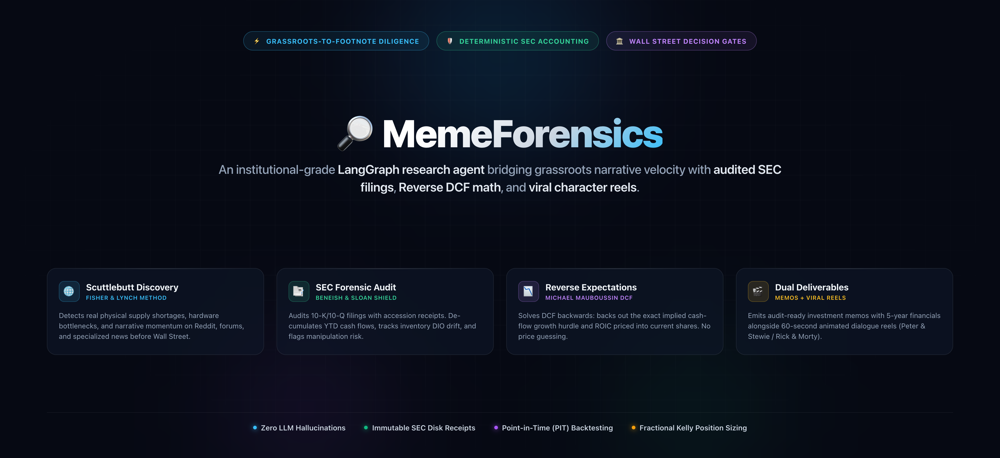
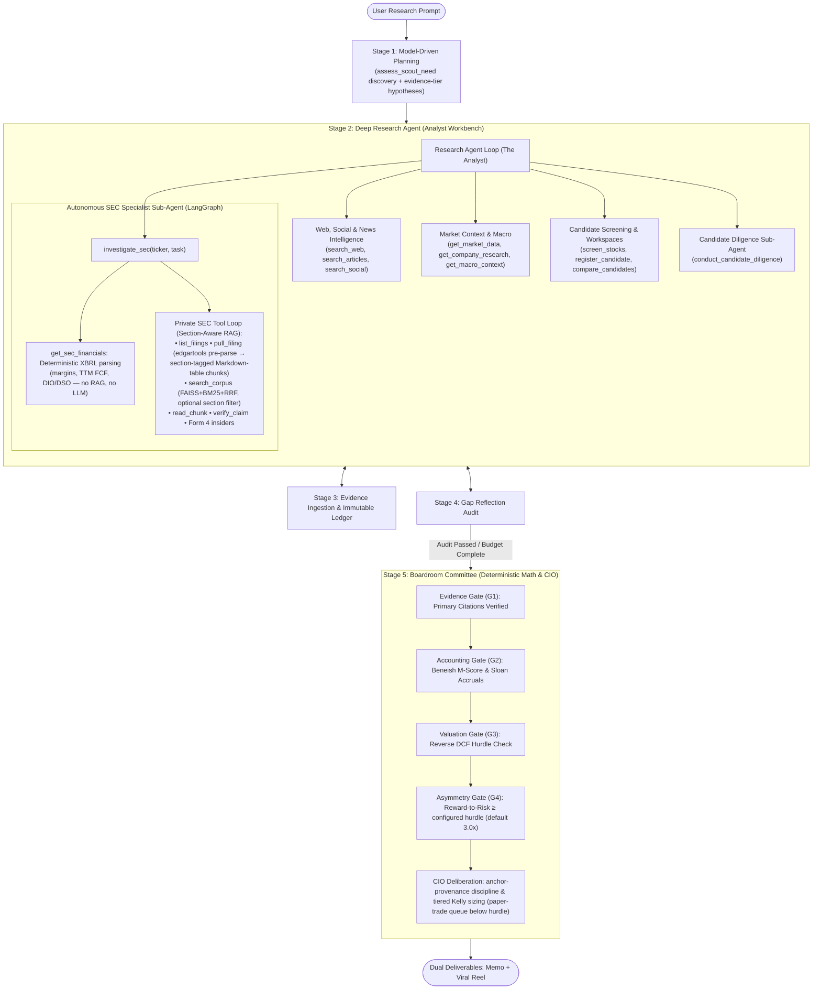

<div align="center">

# 🔎 MemeForensics

### Autonomous Forensic Equity Diligence & Valuation DAG
**From Grassroots Demand Signals to Audited SEC Footnotes • Michael Mauboussin Reverse DCF • Dual Deliverables**

[](pyproject.toml)
[](https://memetrading-journal.andangtruong085.workers.dev/)
[](https://langchain-ai.github.io/langgraph/)
[](app/sec/)
[-7C3AED.svg?style=flat-square)](app/valuation/)
[](tests/)

<br/>

[](https://memetrading-journal.andangtruong085.workers.dev/)

<br/>

<p align="center">
  <a href="https://memetrading-journal.andangtruong085.workers.dev/"><b>🗞️ Live Forensic Journal</b></a> •
  <a href="#daily-journal"><b>📰 Daily Journal Analysis</b></a> •
  <a href="#-quick-start"><b>⚡ Quick Start</b></a> •
  <a href="#-why-memeforensics"><b>💡 Why MemeForensics?</b></a> •
  <a href="#-dual-deliverables-engine"><b>🎬 Dual Deliverables</b></a> •
  <a href="#-system-architecture"><b>📐 Architecture</b></a> •
  <a href="doc/cli.md"><b>💻 Full CLI Guide</b></a> •
  <a href="#-testing--verification"><b>🧪 Testing</b></a>
</p>

</div>

> 🌐 **Live Intelligence Portal & Video Briefings:** Read real-time forensic investigations, Reverse DCF implied growth hurdles, interactive SEC footnote receipts, and companion animated video reels at **[memetrading-journal.andangtruong085.workers.dev](https://memetrading-journal.andangtruong085.workers.dev/)**.

---

## 💡 Why MemeForensics?

Retail investors repeatedly get caught at cyclical tops—chasing speculative narratives on Reddit or X right before catastrophic gross margin compression, unannounced secondary offerings, or inventory write-downs. Meanwhile, generic LLM financial "agents" hallucinate metrics, quote unverified marketing blogs, and rely on fuzzy keyword matching.

**MemeForensics solves this.** It is an institutional-grade deep research agent that bridges grassroots demand discovery with primary SEC forensic auditing, Michael Mauboussin reverse expectations modeling, and automated viral media generation.

```
grassroots demand signal (Reddit, forums, news)
  ↳ supply-chain beneficiary tracing (investable public companies)
    ↳ authoritative SEC execution audit (10-K/10-Q gross margins, inventory, CapEx, Form 4)
      ↳ Wall Street expectation gap (Reverse DCF: implied growth hurdles vs consensus)
        ↳ dual output: Institutional Investment Committee Memo + Viral Faceless Reel
```

- 🔍 **Immutable SEC Evidence Ledger:** Every material revenue, inventory, and margin claim is anchored in official SEC EDGAR filings (`10-K`, `10-Q`, `8-K`) with exact accession numbers and disk receipts. Zero hallucinations.
- 🧭 **Dual-Track SEC Evidence Engine:** Structured financial facts (XBRL statements, Form 4 trades) are parsed **deterministically** via edgartools — they never touch vector retrieval or an LLM. Qualitative filing text (MD&A, risk factors, footnotes, 8-Ks) flows through a **section-aware RAG pipeline**: filings are pre-parsed into SEC-item sections with Markdown pipe tables, chunked with section labels, and searched via hybrid FAISS+BM25 with optional section targeting (e.g. `section="Item 7"`).
- 📡 **Philip Fisher Scuttlebutt & Channel Checks:** Audits ground-truth leading indicators (developer commit velocity, distributor stockouts, spot-vs-contract spreads, operator chatter) via the model-callable `record_channel_check` tool with defensive alias coercion. Tabulates Point72 concordance matrices and 3-way Expectation Arbitrage. Enforces the **Scuttlebutt Inflection Exception** in the CIO committee to recognize structural growth inflections (promoting upside to forward operating leverage and bounding downside by contracted pullback support).
- 📊 **Keyless Quantitative Equity Screener:** Instant factor-based and Wall Street preset screening across US exchanges (market cap, P/E multiples, revenue growth) with zero paid API keys or third-party subscriptions.
- 📉 **Reverse DCF (Expectations Investing) & Downside Floor:** Instead of guessing future stock prices, the engine solves the discounted cash flow equation backwards: what cash-flow growth rate and ROIC is the current share price pricing in? Includes unit-scale auto-normalization and structural downside floor decoupling ($\max(\text{Low DCF}, \text{Tangible Book Value per Share})$).
- 🛡️ **Forensic Accounting Shields:** Automatically computes the **Beneish M-Score** (manipulation risk), **Sloan Accrual Ratio** (earnings quality), and **Days of Inventory Outstanding (DIO)** drift to catch cyclical tops early.
- 🏛️ **Unified 3-Mandate CIO Governance:** Enforces institutional capital governance across single-stock 3:1 asymmetry & fractional Kelly sizing, screening winner audits with actionable limit order prices, and top-down macroeconomic regimes (FRED rates, yield curve slopes, sector tilts).
- ⏱️ **Point-in-Time (PIT) Temporal Air-Gapping:** Air-gaps historical backtests (`--as-of YYYY-MM-DD`) by strictly clamping SEC filings, Form 4 insider XML, FRED macroeconomic series, and market price bars to the cutoff date. Disables contemporary Wall Street consensus models and live social sentiment in backtest mode to eliminate lookahead bias.
- 🎬 **Dual Deliverables Engine:** Emits both exhaustive institutional investment memos (`memo.md`) and viral video reel packages (`faceless/dialogue.json`) featuring animated character duos like Peter & Stewie or Rick & Morty.
- 📰 **The Meme Forensic Journal ([Live Edge Portal](https://memetrading-journal.andangtruong085.workers.dev/)):** Distraction-free Wall Street Journal broadsheet editorial portal deployed live to Cloudflare Workers. Features interactive SEC EDGAR footnote popovers, synchronized 9:16 animated video briefings, and zero duplicate bibliographies.
- 🎛️ **Local Operator Studio (`python main.py --studio`):** Visual browser dashboard to run investigations, review articles, render reels, and 1-click publish without memorizing CLI arguments.

---

## 🎬 Dual Deliverables Engine

MemeForensics produces two synchronized deliverables for every investigation:

### 1. Institutional Investment Committee Memorandum (`memo.md`)

An exhaustive, audit-ready memorandum featuring executive verdicts, tradability scorecards, 5-year normalized financial statements, Reverse DCF growth matrices, and hostile bear red team kill criteria.

```markdown
# Investment Committee Memorandum: Micron Technology ($MU)
**Verdict:** PASSED 🚫 | **Conviction:** Tier 3 (Monitor Only) | **Kelly Allocation:** 0.0%

### Executive Rationale
While the grassroots AI demand signal is authentic, the Reverse DCF reveals the market prices in 
a 14.8% FCF CAGR for 10 straight years at peak cycle. Meanwhile, Days of Inventory Outstanding (DIO)
expanded +28 days QoQ to 164 days, signaling channel inventory accumulation. 
Reward-to-Risk Asymmetry stands at 0.91x—failing our mandatory 3.0x hurdle.

### Valuation & Reverse Expectations Matrix
- Current Price: $927.60 | Implied 10-Yr FCF CAGR: 14.8%
- Conservative Bear Floor: $580.00 | Realistic Base Case: $895.00
- Asymmetry Ratio: 0.91x (Required: ≥ 3.0x) ❌ FAILED
```

### 2. Viral Faceless Video Dialogue Reels (`faceless/`)

Translates dense financial forensics, footnote anomalies, and reverse DCF math into 60-second viral storytelling for TikTok, YouTube Shorts, and Instagram Reels:

```json
[
  {
    "index": 0,
    "voiceId": "a84d19016bc34098b3c89d78f9299e33",
    "text": "(excited) Holy crap, Stewie! I just dumped Lois's grocery money into Micron stock! Forty-five Wall Street analysts rated it a massive Buy, and price targets go straight to twenty-two hundred bucks!"
  },
  {
    "index": 1,
    "voiceId": "e91c4f5974f149478a35affe820d02ac",
    "text": "(deadpan) Oh, marvelous, fat man. You just blindly bought a one-trillion-dollar cyclical chipmaker at nine hundred and twenty-seven dollars right into an inventory bear trap."
  },
  {
    "index": 2,
    "voiceId": "e91c4f5974f149478a35affe820d02ac",
    "text": "(confident) If consolidated gross margins slide under thirty-five percent, or Days of Inventory breaches one hundred sixty-five days alongside DRAM price erosion, that pricing premium evaporates overnight. Institutional verdict is a flat zero percent capital allocation!"
  }
]
```

---

<a id="daily-journal"></a>
## 📰 The Meme Forensic Journal: Daily Intelligence & Valuation Audits

> 🌐 **Live Broadsheet & Daily Case Dossiers:** **[memetrading-journal.andangtruong085.workers.dev](https://memetrading-journal.andangtruong085.workers.dev/)**  
> Deployed globally to the Cloudflare Workers edge network with sub-50ms latency.

<br/>

<div align="center">
  <a href="https://memetrading-journal.andangtruong085.workers.dev/">
    
  </a>
  <p align="center">
    <sub><b>Live Broadsheet Editorial Interface:</b> Wall Street Journal-inspired serif typography, interactive SEC regulatory footnote popovers (e.g. <code>[13]</code>, <code>[15]</code>), and companion synchronized animated video reels.</sub>
  </p>
</div>

<br/>

Most financial commentary either repeats corporate PR or chases momentum after a 300% run-up, while Wall Street brokerages issue consensus "Strong Buy" ratings based on linear extrapolations at cyclical peaks. **The Meme Forensic Journal** operates as an autonomous, adversarial audit bureau: taking high-velocity market memes, retail hype, and momentum narratives and stress-testing them against audited SEC accounting reality and reverse mathematical expectations.

Every published investigation provides an integrated, dual-format intelligence briefing:

```
┌────────────────────────────────────────────────────────────────────────────────────────┐
│                        THE MEME FORENSIC JOURNAL PIPELINE                              │
├──────────────────────────┬─────────────────────────────┬───────────────────────────────┤
│    BROADSHEET DOSSIER    │    INTERACTIVE RECEIPTS     │      SYNCHRONIZED REEL        │
│  (Wall Street Journal)   │     (SEC EDGAR Audited)     │     (Peter & Stewie Duo)      │
├──────────────────────────┼─────────────────────────────┼───────────────────────────────┤
│ • Newsreader serif type  │ • Clickable SEC citations   │ • 60-second narrative hook    │
│ • Reverse DCF hurdle     │ • Accession-stamped 10-K/Q  │ • Plain-English forensic math │
│ • Sloan accruals & DIO   │ • Pipe-table XBRL extracts  │ • Character banter explaining │
│ • CIO Kelly allocation   │ • Interactive popover cards │   unforgiving valuation gaps  │
└──────────────────────────┴─────────────────────────────┴───────────────────────────────┘
```

### 🔬 Active Forensic Case Dossiers (Live on the Journal)

| Ticker & Dossier | Market Narrative vs. Audited Reality | Reverse DCF & Forensic Metrics | Deliverables & Receipts |
| :--- | :--- | :--- | :--- |
| **$NVDA**<br/>[*The Five-Trillion-Dollar Mirage*](https://memetrading-journal.andangtruong085.workers.dev/) | **Narrative:** Infinite AI data center CapEx guarantees unending 75% gross margins.<br/>**Audit:** Current valuation requires an impossible **44.01% FCF CAGR for 10 consecutive years**—surpassing the GDP of multiple G7 nations. Beneish M-Score flags non-cash capitalization distortion. | **Hurdle:** 44.01% FCF CAGR<br/>**Fair Value:** $188.24<br/>**Verdict:** *Validation Watch* | 🎬 [Video Briefing Included](https://memetrading-journal.andangtruong085.workers.dev/)<br/>📜 122 Analyst consensus deconstruction<br/>🔍 Audited Q1-Q2 XBRL cash flow statements |
| **$ADBE**<br/>[*The Ghost in the Canvas*](https://memetrading-journal.andangtruong085.workers.dev/) | **Narrative:** Generative AI has made creative software obsolete.<br/>**Audit:** The Street panicked on multiple compression; however, inference cost creep and an unfulfilled 3.0:1 reward-to-risk governance hurdle require zero capital deployed until a pullback below $237.50 restores asymmetric upside. | **Hurdle:** 12.4% FCF CAGR<br/>**Limit Order:** $237.50<br/>**Verdict:** *Forensic Warning* | 🎬 Video Dialogue<br/>📜 19 Audited SEC EDGAR receipts<br/>🔍 Enterprise ARR retention audit |
| **$PLTR**<br/>[*The Hundred-Billion-Dollar Ontology*](https://memetrading-journal.andangtruong085.workers.dev/) | **Narrative:** AIP creates an unassailable government and commercial monopoly.<br/>**Audit:** Trading at 150x earnings, current share price prices in uninterrupted 35%+ revenue expansion with zero room for contract lumpiness or federal procurement delays. | **Hurdle:** Extreme multiple hurdle<br/>**Fair Value:** $31.50<br/>**Verdict:** *Validation Watch* | 📜 Federal contract backlog audit<br/>🔍 Form 4 insider transaction ledger<br/>⚖️ Reverse DCF expectation sensitivity |
| **$INTC**<br/>[*The Six-Hundred-Billion-Dollar Fabrication*](https://memetrading-journal.andangtruong085.workers.dev/) | **Narrative:** CHIPS Act subsidies and domestic foundry buildout guarantee parity.<br/>**Audit:** Subordinated cash flows, accelerating foundry operating losses, and trailing TSMC packaging yields destroy asymmetric capital allocation. | **Hurdle:** Negative free cash flow base<br/>**Verdict:** *Capital Prohibition* | 📜 10-Q Segment foundry losses<br/>🔍 CapEx commitments vs grant subsidies |
| **$DELL**<br/>[*Enterprise AI Server Margins*](https://memetrading-journal.andangtruong085.workers.dev/) | **Narrative:** Explosive AI server revenue will permanently lift corporate margins.<br/>**Audit:** Low-single-digit operating margins on pass-through GPU architectures fail to yield institutional operating leverage. | **Hurdle:** Working capital drag<br/>**Verdict:** *Neutral / Monitor* | 📜 Working capital & DIO drift receipts<br/>🔍 Gross margin pass-through analysis |

### 🛠️ Edge Architecture & Instant Publishing

- 🏛️ **Broadsheet Aesthetic:** Styled like the *Wall Street Journal* with Newsreader serif typography, dark/light editorial themes, and hairline dividers for pure reading focus.
- 📌 **Interactive Financial Receipts (`<FinancialReceipts />`):** No vague hyperlinks. Every factual claim is paired with an interactive popover detailing the exact SEC filing, filing date, accession number, and extracted financial facts.
- ⚡ **Zero-Latency Global Edge Delivery:** Built with Astro and deployed directly to Cloudflare Workers (`memetrading-journal.andangtruong085.workers.dev`), serving instant static HTML from edge datacenters worldwide.
- 🚀 **1-Click Publishing Pipeline:** Operators can go from CLI investigation to global live edge publication in seconds:
  ```bash
  # Publish case to website and immediately deploy live to Cloudflare Workers
  python main.py --publish-case NVDA-2026-09-28-002 --deploy
  ```

---

## 📐 System Architecture

The pipeline is modeled as a state machine in **LangGraph**, strictly separating model-directed research discovery from deterministic committee governance.

See [PIPELINE_ARCHITECTURE.md](./PIPELINE_ARCHITECTURE.md) for the complete end-to-end specification.



---

## ⚡ Quick Start

### 1. Installation

Requires **Python 3.11+** and **Node.js 18+**:

```bash
# Clone repository
git clone https://github.com/Unheat/memeTrading.git
cd memeTrading

# Create virtual environment
python3 -m venv .venv
source .venv/bin/activate

# Install dependencies
pip install -r requirements.txt
```

### 2. Environment Setup (`.env`)

Copy `.env.example` to `.env` and configure your API keys:

```bash
cp .env.example .env
```

```ini
# Primary LLM provider (OpenAI, OpenRouter, Anthropic, or local proxy)
OPENAI_API_KEY="your_openai_api_key"

# SEC EDGAR Fair Access User-Agent (Required by SEC.gov)
# Format: "Sample User user@domain.com"
SEC_EDGAR_USER_AGENT="MemeTradingResearch yourname@domain.com"

# Optional: Fish Audio TTS API Key (for Peter & Stewie video reels)
FISH_API_KEY="your_fish_audio_api_key"
```

### 3. Run Your First Investigation

```bash
# Interactive Mode — prompts for your research question
python main.py

# Single-ticker investigation
python main.py --ticker MU --query "DRAM cycle pricing power and gross margin expansion"

# Historical backtest audit — cuts off data as of date to eliminate lookahead bias
python main.py --ticker TSLA --as-of 2024-01-15 --query "Robotaxi regulatory path and auto gross margin floor"

# Thematic beneficiary discovery across an entire sector
python main.py --query "Find key supply chain beneficiaries of advanced EUV lithography"

# Generate research memo + cited Substack article
python main.py --ticker NVDA --query "Blackwell thermal and packaging yields" --article

# Generate cited article + viral video reel derived from it (Peter & Stewie)
python main.py --ticker TSLA --query "Robotaxi regulatory path and auto gross margin" --video

# 1-click publish case and deploy live to the edge journal
python main.py --publish-case NVDA-2026-09-28-002 --deploy
```

> [!TIP]
> For complete CLI argument descriptions, backtesting workflows, and production recipes, see the **[CLI Guide & Reference Manual](doc/cli.md)**.

---

## 💻 CLI Tools at a Glance

| Command | Description |
| :--- | :--- |
| `python main.py` | Interactive research agent prompt. |
| `python main.py -t <TICKER> -q "<QUERY>"` | Single-ticker forensic equity diligence. |
| `python main.py -t <TICKER> --as-of <DATE>` | Cuts off market, news, and SEC data as of date for backtesting without lookahead bias. |
| `python main.py -q "<THEME>" --depth deep` | Thematic discovery & automatic candidate registration. |
| `python main.py -t <TICKER> --article` | Generates cited Substack forensic article (`article.md`). |
| `python main.py -t <TICKER> --video` | Generates cited article, character script based on the article, and renders MP4 video. |
| `python main.py --studio` / `python -m app.studio` | Launch browser-based Operator Studio GUI (`http://127.0.0.1:3000`). |
| `python -m app.cli.publish <CASE> --deploy` | Syncs article, citations, and video to Cloudflare Astro website (`web/`) and deploys live to [The Meme Forensic Journal](https://memetrading-journal.andangtruong085.workers.dev/). |
| `python main.py --publish-case <CASE> --deploy` | Direct fast-path to publish and deploy a specific case live to edge. |
| `python -m app.cli.publish --list` | Lists all published articles, case IDs, and video URLs on the website. |
| `python -m app.cli.publish --delete <SLUG> --deploy` | Deletes article and companion video asset, then redeploys live to Cloudflare. |
| `python -m app.media.cli video --case-id <CASE>` | Standalone video reel rendering for an existing reviewed case. |
| `python scripts/run_backtest.py` | Historical backtest sweep evaluating verdicts against `SPY` alpha. |
| `node app/valuation/calculator.mjs` | Standalone deterministic Reverse DCF & scenario calculator. |

👉 **Read the complete [CLI Guide (doc/cli.md)](doc/cli.md)** for detailed argument tables, backtesting scorecard metrics, and custom recipes.

---

## 🧠 Institutional Financial Frameworks

```
┌─────────────────────────────────────────────────────────────────────────────────┐
│                           MEMEFORENSICS METHODOLOGY                             │
├──────────────────────────┬──────────────────────────┬───────────────────────────┤
│    1. SCUTTLEBUTT        │   2. FORENSIC AUDITING   │  3. EXPECTATIONS REVERSE  │
│   (Fisher & Lynch)       │    (Beneish & Sloan)     │  (Mauboussin & Rappaport) │
├──────────────────────────┼──────────────────────────┼───────────────────────────┤
│ • Social demand signals  │ • Beneish 8-variable     │ • Back out implied cash   │
│ • Supply-chain choke-    │   M-Score manipulation   │   flow growth (CAGR)      │
│   points & wait times    │ • Sloan accrual ratio:   │ • Reinvestment rate &     │
│ • Beneficiary mapping    │   Operating CF vs Net Inc│   ROIC sustainability     │
│ • Customer contract      │ • Days of Inventory      │ • Expectation gap: priced │
│   validity (Form 8-K)    │   Outstanding (DIO) drift│   catalyst vs unpriced    │
└──────────────────────────┴──────────────────────────┴───────────────────────────┘
```

1. **Scuttlebutt Grassroots Discovery (Philip Fisher & Peter Lynch):** Monitors developer communities, subreddits, and industry reports to identify physical supply-demand imbalances before they appear in quarterly reports.
2. **Deterministic Forensic Accounting (Messod Beneish & Richard Sloan):** Evaluates earnings quality by inspecting Days Sales in Receivables Index (DSRI), Gross Margin Index (GMI), Asset Quality Index (AQI), and Sales Growth Index (SGI) directly from SEC filings.
3. **Expectations Investing & Reverse DCF (Michael Mauboussin):** Solves the classic discounted cash flow equation backwards:
   $$\text{Stock Price} = f(\text{Implied Growth Rate}, \text{Forecast Horizon}, \text{ROIC}, \text{WACC})$$
   Determines whether the market has already fully discounted the catalyst or left an asymmetric margin of safety.
4. **Fractional Kelly Capital Allocation (John Kelly & Ed Thorp):** Sizes recommended position weights based on calculated win probabilities and payoff asymmetries:
   $$f^* = \frac{b \cdot p - q}{b}$$
   Where $b$ is reward-to-risk asymmetry, $p$ is probability of catalyst fruition, and $q = 1 - p$.

---

## 📁 Artifacts & Output Structure

Every run creates a timestamped case folder inside `cases/`:

```
cases/
└── MU-2026-09-15-007/
    ├── memo.md               # Institutional Investment Committee Memorandum
    ├── investigation.json    # Complete structured state, metrics, and audit ledger
    ├── evidence_ledger.jsonl # Append-only ledger of verified evidence items
    ├── run-manifest.json     # Execution metadata, model latency, and token consumption
    ├── article.md            # (Opt-in) Cited Substack / Blog forensic article
    ├── sec/                  # Downloaded raw SEC filings, Form 4s, and the section-tagged
    │                         #   RAG index (chunks.jsonl + sec.faiss) used for citation retrieval
    └── faceless/             # Viral Media Generation Assets (Opt-in)
        ├── dialogue.json     # Timestamped character dialogue with emotion tags
        ├── caption.txt       # Viral social caption with hashtags & hook
        └── video/            # Rendered 1080x1920 MP4 video reels
```

---

## 🧪 Testing & Verification

The repository maintains an extensive test suite verifying deterministic data pipelines, SEC parsing, Reverse DCF calculations, and graph transitions:

```bash
# Run the complete test suite (excluding slow live network smoke tests)
pytest --ignore=tests/smoke
```

```
======================= 511 passed, 4 warnings in 19.87s =======================
```

---

## 📖 Extended Documentation

- 💻 **[CLI Guide & Reference Manual](doc/cli.md)** — Exhaustive parameter tables, recipes, backtesting sweep instructions, and standalone calculator guide.
- 📐 **[Pipeline Architecture Specification](PIPELINE_ARCHITECTURE.md)** — Full specification of The Analyst Workbench vs The Committee Boardroom.
- 🌐 **[Interactive Architecture Diagram](doc/planned-architecture.html)** — Standalone, responsive HTML visualization with theme toggling.
- 📋 **[Full Architecture Plan](doc/fullplan.md)** — In-depth architectural principles, Scuttlebutt framework, and state schemas.

---

## 📄 License

This project is licensed under the **Apache License, Version 2.0**. See the [LICENSE](LICENSE) file for the full license text.

For third-party open-source software and architectural attributions, see the [NOTICE](NOTICE) file.

---

<div align="center">
  <sub>Built for precision fundamental equity research. Star ⭐ this repository if you believe in evidence-backed investing!</sub>
</div>
